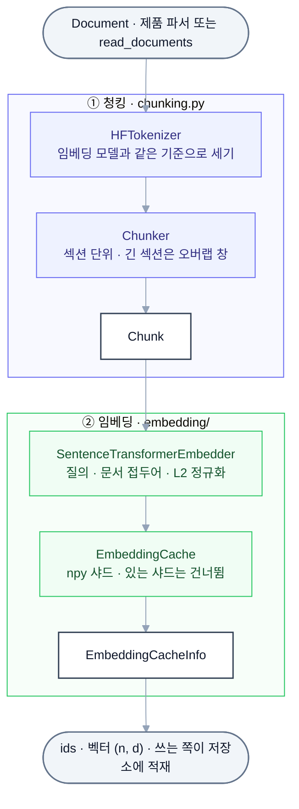

# llm-playground-corpus

llm-playground 프로젝트들이 함께 쓰는 코퍼스 모듈입니다. 정제된 문서(`Document`)를 받아 섹션 단위 청크(`Chunk`)로 나누고, 청크를 임베딩해 npy 샤드 캐시로 내놓습니다. 패키지 이름은 `playground_corpus`이고, 문서를 어디서 읽을지 · 벡터를 어디에 넣을지는 쓰는 쪽(llm-playground-retrieval · llm-playground-wiki)이 정합니다.

## 전체 흐름



## 폴더 구조

```
llm-playground-corpus/
├─ src/playground_corpus/
│  ├─ types.py        Document · Section · Chunk
│  ├─ tokenizer.py    Tokenizer Protocol · HFTokenizer
│  ├─ chunking.py     Chunker · ChunkingConfig
│  ├─ parquet.py      read_documents · write_documents ([parquet] extras)
│  └─ embedding/      Embedder Protocol · EMBEDDING_MODELS · SentenceTransformerEmbedder ([local] extras) · EmbeddingCache
├─ bench/
│  ├─ embed_compare.py  임베딩 모델 × 청크 크기 비교 벤치
│  └─ data/           임베딩 캐시 · 문항별 기록 (git 제외)
├─ models/            선정 결과 yaml (kure-v1.yaml)
├─ reports/           벤치 결과 — 집계 지표만 커밋
├─ tests/             단위 테스트 · 토크나이저 계약 테스트
├─ .ruff/             공유 ruff 설정 복사본 (직접 고치지 않음)
├─ pyproject.toml     의존성 · extras (uv)
└─ ruff.toml          ruff 설정
```

## 기술 스택

| 구분 | 사용 |
| --- | --- |
| 언어 · 환경 | Python 3.13 이상, uv |
| 기본 설치 | NumPy, tokenizers (HF) |
| 임베딩 모델 실행 | PyTorch, sentence-transformers (`[local]` extras). 후보 BAAI/bge-m3, nlpai-lab/KURE-v1, nlpai-lab/KoE5 |
| 문서 입출력 | pyarrow (`[parquet]` extras) |
| 벤치 지표 | `playground_evalkit` (`bench` 그룹, git 태그로 설치) |

## 빠르게 실행해 보기

[uv](https://docs.astral.sh/uv/)를 설치한 상태에서 시작합니다.

### 1. 패키지 설치

```bash
uv sync
```

기본 의존성(NumPy · tokenizers)과 개발 도구(pytest · ruff)를 설치합니다. torch · pyarrow는 extras라 여기서 깔리지 않습니다.

### 2. 문서를 청크로 나눠 보기

```bash
uv run python -c "
from playground_corpus import Chunker, ChunkingConfig, Document, HFTokenizer, Section
text = '서울특별시는 대한민국의 수도이자 최대 도시이다. 조선 시대에는 한양으로 불렸으며 한강이 도시를 가로질러 흐른다.'
document = Document(id='1', title='서울특별시', text=text, sections=(Section(0, '', text),))
chunker = Chunker(HFTokenizer.from_pretrained('nlpai-lab/KURE-v1'), ChunkingConfig(max_tokens=384))
for chunk in chunker.chunk(document):
    print(chunk.id, chunk.token_count, repr(chunk.text[:20]))
"
```

`from_pretrained`는 HF 허브에서 `tokenizer.json`을 받아 HF 캐시에 둡니다. `1-0 33 '서울특별시\n서울특별시는 대한민국의 수'`처럼 청크 id · 토큰 수 · 머리줄이 붙은 본문 앞부분이 나오면 준비 완료입니다.

### 3. (선택) 임베딩 모델 올리기

```bash
uv sync --all-extras
uv run python -c "
from playground_corpus import EMBEDDING_MODELS, SentenceTransformerEmbedder
embedder = SentenceTransformerEmbedder.load(EMBEDDING_MODELS['kure-v1'])
print(embedder.encode_queries(['조선의 수도는?']).shape)
"
```

`--all-extras`는 torch(개발 환경은 CUDA 12.8 빌드) · sentence-transformers · pyarrow를 설치합니다. `load`는 모델을 받아 GPU가 있으면 GPU에 반정밀도로, 없으면 CPU에 올립니다. `(1, 1024)`가 나오면 성공입니다. extras 없이 쓰면 설치 안내가 담긴 `ImportError`가 납니다.

## 사용법

### 설치

```bash
# 기본 — 타입 · 토크나이저 · Protocol (numpy, tokenizers)
uv add "playground-corpus @ git+https://github.com/calm-sea-psy/llm-playground-corpus@v0.1.0"

# parquet 읽기 · 쓰기
uv add "playground-corpus[parquet] @ git+https://github.com/calm-sea-psy/llm-playground-corpus@v0.1.0"

# 임베딩 모델 실행 (torch, sentence-transformers)
uv add "playground-corpus[local] @ git+https://github.com/calm-sea-psy/llm-playground-corpus@v0.1.0"
```

0.x 동안은 깨는 변경이 있을 수 있습니다. 이 레포와 함께 고칠 때는 같은 부모 폴더에 나란히 clone 하고 잠깐 path로 바꿔 씁니다: `{ path = "../llm-playground-corpus", editable = true }`.

### 주요 API

| 함수 · 클래스 | 역할 | 비고 |
| --- | --- | --- |
| `Document(id, title, text, sections, categories, meta)` | 정제된 문서 하나 | `meta`는 source · url · dump_date 등 문자열 |
| `Section(level, title, text)` | 문서 안의 섹션 | 첫 헤더 앞 본문은 `level` 0 · 제목 빈 문자열 |
| `Chunk` | 임베딩 · 검색 단위 | `id`는 `{doc_id}-{seq}`, `text`는 `"{제목} > {섹션}\n{본문}"` (첫머리는 `"{제목}\n{본문}"`) |
| `Tokenizer` | `count` · `spans` 계약 (Protocol) | 특수 토큰은 뺌 |
| `HFTokenizer.from_pretrained(model_id)` · `from_file(path)` | HF `tokenizers` 구현 | `tokenizer.json`의 자르기 · 패딩 설정은 끄고 셈 |
| `ChunkingConfig(max_tokens, overlap_ratio, min_chars)` | 청킹 설정 | 기본 384 · 0.15 · 50 |
| `Chunker(tokenizer, config).chunk(document)` | 문서 → 청크 목록 | 창 끝은 문단 → 문장 경계에 맞춤. 본문이 `min_chars`보다 짧은 청크는 버림 |
| `Embedder` | `encode_queries` · `encode_passages` 계약 (Protocol) | `(n, d)`, 행마다 L2 정규화 |
| `EMBEDDING_MODELS` · `EmbeddingModelSpec` | 후보 모델 정의 | 아래 표 |
| `SentenceTransformerEmbedder.load(spec)` | sentence-transformers 임베더 | `[local]` extras |
| `EmbeddingCache(directory).write(embedder, ids, texts)` · `load()` · `info()` | `emb-xxxxx.npy` + `.ids.json` 샤드 캐시 | 샤드 5만 개 단위, 있는 샤드는 건너뛰어 중단 뒤 이어 돌림 |
| `write_documents(documents, path)` · `read_documents(path)` | Document ↔ parquet | `[parquet]` extras |

| `EMBEDDING_MODELS` 키 | 모델 | 차원 | 최대 길이 | 접두어 |
| --- | --- | --- | --- | --- |
| `bge-m3` | BAAI/bge-m3 | 1024 | 8192 | 없음 |
| `kure-v1` | nlpai-lab/KURE-v1 | 1024 | 8192 | 없음 |
| `koe5` | nlpai-lab/KoE5 | 1024 | 512 | `query: ` · `passage: ` |

## 명령어

임베딩 모델 × 청크 크기 비교 벤치(`bench/embed_compare.py`)입니다. llm-playground-wiki(옛 llm-playground-rag)가 만든 서브셋과 KorQuAD dev로 검색 품질(hit@k · MRR) · 처리량 · VRAM을 잽니다. 서브셋 데이터를 파일로만 읽으므로(import 하지 않음) llm-playground-wiki를 같은 부모 폴더에 나란히 clone 해 둡니다.

| 명령 | 옵션 | 설명 |
| --- | --- | --- |
| `embed_compare.py` | `--subset` (기본 `../llm-playground-wiki/data/parsed/kowiki-subset-10000`) · `--korquad` (기본 `subset.json`의 `korquad_dev`) · `--models` (기본 전부) · `--max-tokens` (기본 256 384 512) · `--limit-docs` · `--batch-size` (기본 64) · `--run-id` | 조합마다 청킹 · 임베딩 → numpy 전수 비교 검색 → 채점 |

```bash
uv run --group bench --extra parquet --extra local python bench/embed_compare.py
```

모든 모델 × 크기 조합을 돌립니다. 임베딩은 `bench/data/emb/`에 캐시해 다시 계산하지 않고, 문항별 기록은 `bench/data/runs/{run_id}/`, 집계 표는 `reports/{run_id}.md`에 씁니다.

```bash
uv run --group bench --extra parquet --extra local python bench/embed_compare.py --models bge-m3 --max-tokens 384 --limit-docs 300 --run-id smoke
```

모델 · 크기 · 문서 수를 줄인 시험 실행입니다.

## 테스트

```bash
uv sync --all-extras
uv run pytest
uv run ruff check
```

`tests/test_chunking_contract.py`는 청커가 센 토큰 수가 실제 모델 토크나이저와 같은지 확인합니다. 토크나이저 파일을 HF 허브에서 받으므로 네트워크가 없으면 로컬에서는 건너뛰고, `CI` 환경 변수가 있으면 실패합니다.

```bash
uv sync
uv run pytest tests/test_import_base.py
```

extras 없이 설치한 환경에서 base import가 extras를 올리지 않는지 봅니다. CI(`.github/workflows/ci.yml`)는 `main` push와 PR에서 이 두 묶음을 각각 돌리고, `.github/workflows/pr-lint.yml`은 PR 제목 · 본문 규칙을 검사합니다.

## 실험 결과

kowiki 서브셋 1만 · KorQuAD dev 5,766문항으로 잰 임베딩 비교입니다 ([reports/2026-10-22-embed-compare.md](reports/2026-10-22-embed-compare.md)). 서브셋 수치는 방해 문서가 적어 전체 코퍼스보다 높게 나오므로 상대 비교 전용입니다.

| 모델 | hit@5 (256) | hit@5 (384) | hit@5 (512) | MRR@10 (384) | 처리량 청크/초 (384) | VRAM GB (384) |
| --- | --- | --- | --- | --- | --- | --- |
| **kure-v1** | 0.867 | **0.850** | 0.836 | 0.762 | 203.4 | 1.64 |
| bge-m3 | 0.827 | 0.806 | 0.793 | 0.701 | 206.1 | 1.64 |
| koe5 | 0.816 | 0.802 | 0.792 (실제 508) | 0.692 | 205.8 | 1.63 |

선정은 **KURE-v1 · 384토큰 · 오버랩 0.15 · 최소 50자**이고 근거는 [models/kure-v1.yaml](models/kure-v1.yaml)에 있습니다. KURE-v1은 모든 청크 크기에서 hit@5가 4~5%p 높고 처리량 · VRAM은 비슷합니다. Dense 단독은 256이 높지만 리랭커를 붙이면 384가 같거나 높고, 384는 벡터가 약 22% 적습니다.
